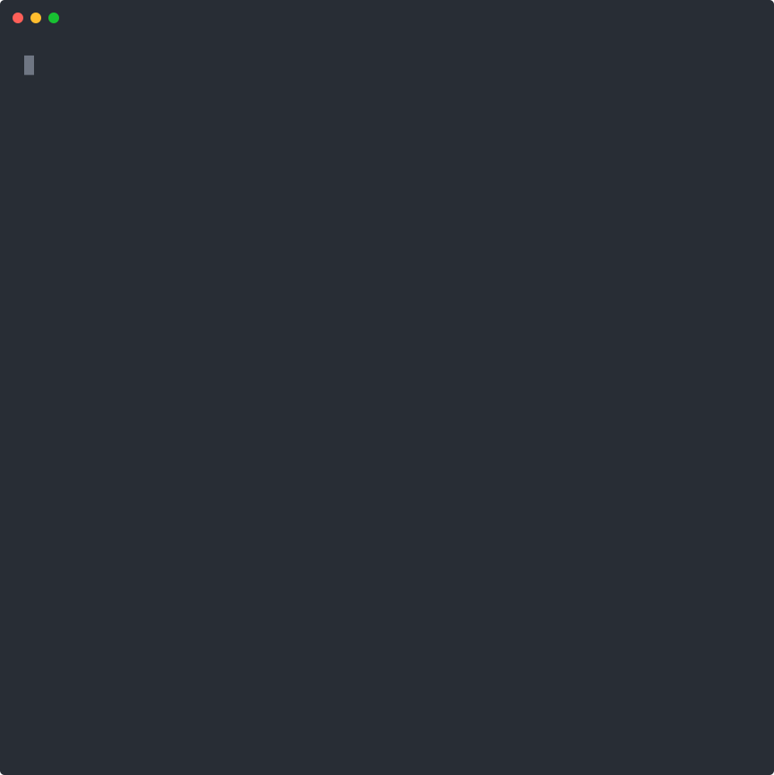

# Serengeti

Serengeti is a small replicated database in one jar. Databases hold tables, tables hold JSON rows, and
you query them over an authenticated HTTP API with a short SQL-like language. A cluster is 1 to 7 nodes
that each hold every database.

What sets it apart is what happens when the network splits. By default a write needs a majority of the
nodes, like most replicated databases. Ask for `"ack": "local"` instead and a node that is cut off keeps
accepting writes; when the network comes back the nodes merge, and every node ends up with the same rows.
Two writes to the same row that never saw each other are not silently dropped: the newer one becomes the
row's value everywhere, and `SHOW CONFLICTS` lists both until the next write to the row settles it.

That suits places where the link to the other nodes is the least reliable part: a shop, a depot, a
vehicle, a site office.



The recording is a real run of [docs/demo.sh](docs/demo.sh), which anyone with Docker can run. CI runs it
on every change.

## Quick start

Build the image and start one node. The node writes a one-time setup token to `/data/setup-token` on its
first start, and answers every request except `GET /health`, `GET /ready` and `POST /v1/setup` with 503
until the admin password is set with it:

```sh
docker build -t serengeti .
docker run -d --name serengeti -p 127.0.0.1:1985:1985 -v serengeti-data:/data serengeti
```

Set the admin password and run queries. The commands keep the password in `SERENGETI_PASSWORD`; choose
your own.

```sh
# Wait until the node answers, then set the admin password with the one-time setup token.
for _ in $(seq 60); do curl -sf http://127.0.0.1:1985/health >/dev/null && break; sleep 1; done
export SERENGETI_PASSWORD='choose a long password'
token=$(docker exec serengeti cat /data/setup-token)
curl -s -H 'Content-Type: application/json' \
  --data "{\"token\": \"$token\", \"password\": \"$SERENGETI_PASSWORD\"}" http://127.0.0.1:1985/v1/setup; echo
# {"user":"admin"}
```

```sh
q() { curl -s -u "admin:$SERENGETI_PASSWORD" -H 'Content-Type: application/json' \
        --data "{\"query\": \"$1\"}" http://127.0.0.1:1985/v1/query; echo; }

q "CREATE DATABASE shop"
q "CREATE TABLE shop.items"
q "INSERT INTO shop.items (name, qty) VALUES ('bolt', 120), ('nut', 300)"
q "SELECT name, qty FROM shop.items WHERE qty > 200"
# {"type":"rows","columns":["name","qty"],"rows":[["nut",300]],"count":1,"truncated":false}
```

The console is at http://127.0.0.1:1985/ and asks for the same user name and password. The image also
has a shell that prints results as a table:

```
$ docker exec -it -e SERENGETI_PASSWORD serengeti serengeti shell
serengeti> SELECT name, qty FROM shop.items ORDER BY qty
name | qty
-----+----
bolt | 120
nut  | 300
(2 rows, 8 ms)
```

`-c 'STATEMENT'` runs statements and exits, and `--format tsv` or `--format json` suit scripts;
`serengeti shell --help` lists the rest.

To set the password when the node first starts, pass `-e SERENGETI_ADMIN_PASSWORD` to `docker run`
(the value is taken from your shell), and skip the setup step.

The [examples](examples/) run the same steps from curl, Python (`urllib`) and JavaScript (`fetch`). The
quick start is run by [docs/quickstart.sh](docs/quickstart.sh), and the examples by
[examples/run.sh](examples/run.sh); both are run in CI.

Without Docker, build with `mvn package` (Java 17 or later) and run
`java -jar target/Serengeti-2.2.0-SNAPSHOT-jar-with-dependencies.jar`. It listens on 127.0.0.1:1985 and
keeps its data in `./data`.

## A cluster

A cluster is the same image with `SERENGETI_PEERS`, a shared cluster key and TLS between the nodes.
[examples/cluster/compose.yaml](examples/cluster/compose.yaml) runs three nodes with Docker Compose, and
the image's `serengeti-certs` makes their certificates:

```sh
cd examples/cluster
printf 'SERENGETI_ADMIN_PASSWORD=%s\nSERENGETI_CLUSTER_KEY=%s\n' "$SERENGETI_PASSWORD" "$(head -c 32 /dev/urandom | base64)" > .env
docker compose run --rm certs
docker compose up -d
```

The nodes are published on 127.0.0.1, ports 19851 to 19853, and clients check them against the CA in
`ca.pem`:

```sh
docker compose run --rm --entrypoint cat certs /certs/ca.pem > ca.pem
curl --cacert ca.pem -u "admin:$SERENGETI_PASSWORD" https://127.0.0.1:19851/v1/status; echo
```

The comments in the Compose file say more, and [docs/CONFIGURATION.md](docs/CONFIGURATION.md) has the
settings. CI runs this example as written. [examples/monitoring](examples/monitoring/) adds Prometheus,
18 tested alert rules and a Grafana dashboard to it.

## Writes in a cluster

A write goes to any node. With the default, `"ack": "majority"`, the node answers 200 once a majority of
the cluster has the write on disk, and 503 when it cannot reach a majority. With `"ack": "local"`, it
answers 200 once the write is on its own disk and passes it on to the nodes it can reach; the rest get it
through sync when they can. Choose per request, or set `SERENGETI_WRITE_ACK` for a node's default.

```
POST /v1/query
{"query": "UPDATE shop.items SET qty = 90 WHERE name = 'bolt'", "ack": "local"}
```

Reads answer from the node's own data unless you ask for `"consistency": "majority"`, which syncs with a
majority first. [docs/CONSISTENCY.md](docs/CONSISTENCY.md) has the details, including how conflicts are
detected (a version vector per row write) and what a 503 means.

## Indexes

```sh
q "CREATE INDEX ON shop.items (qty)"
q "SELECT name FROM shop.items WHERE qty > 200"
```

A `WHERE` that compares an indexed column with a value, checks it against an IN list or a LIKE prefix
(`name LIKE 'bo%'`), alone or as one term of an AND, reads only the matching rows; anything else scans
the table. Lookups by `_id` never scan. Indexes change how fast a
query runs, not what it returns. [docs/QUERY.md](docs/QUERY.md) has the rules.

## Accounts

The admin makes an account for each application or person, with one of four roles: `metrics` (`/metrics`
and `/v1/status` only, for a monitoring system), `read` (SELECT and SHOW), `write` (also writes and schema
changes) or `admin` (also accounts and backups).

```sh
curl -s -u "admin:$SERENGETI_PASSWORD" -X PUT -H 'Content-Type: application/json' \
  --data '{"password": "a long password for the dashboard", "role": "read"}' \
  http://127.0.0.1:1985/v1/users/dashboard; echo
# {"user":"dashboard","role":"read"}
```

A write by a read account gets 403. A read or write account can also be limited to some databases; it then
gets 403 for any statement or change feed that names another one, and `SHOW DATABASES` lists only its own:

```sh
curl -s -u "admin:$SERENGETI_PASSWORD" -X PUT -H 'Content-Type: application/json' \
  --data '{"password": "a long password for the shop", "role": "write", "databases": ["shop"]}' \
  http://127.0.0.1:1985/v1/users/shop-app; echo
# {"user":"shop-app","role":"write","databases":["shop"]}
```

In a cluster, accounts replicate: an account's role, databases and password merge apart, the newest change
to each winning on every node, a delete is not undone by changes made where it had not arrived, and a node
that was down catches up.
[docs/API.md](docs/API.md#accounts) has the rest.

## Following changes

`GET /v1/changes` returns the changes a node applied after a cursor, waiting up to 60 s for the next one,
so a cache, a search index or a screen can follow a table instead of polling it:

```sh
cursor=$(curl -s -u "admin:$SERENGETI_PASSWORD" 'http://127.0.0.1:1985/v1/changes?db=shop&after=now' \
  | sed 's/.*"cursor":"\([^"]*\)".*/\1/')
curl -s -u "admin:$SERENGETI_PASSWORD" "http://127.0.0.1:1985/v1/changes?db=shop&table=items&after=$cursor&wait=30"
```

The [clients](clients/) wrap this as `follow()`. A node keeps its recent changes in memory only, so a
cursor from before a restart gets 410: read the table again and follow from now. See
[docs/API.md](docs/API.md#changes).

## How it compares

| | Serengeti 2.2 | rqlite | CouchDB | cr-sqlite |
|---|---|---|---|---|
| Shape | one jar or image, HTTP API | one binary, HTTP API | server, HTTP API | SQLite extension |
| Data and queries | JSON rows, a small SQL-like language (IN, LIKE, DISTINCT, aggregates with GROUP BY and HAVING, indexes on 1 to 4 columns), no joins | SQLite, full SQL | JSON documents, Mango and map/reduce views | SQLite, full SQL |
| Writes when a node is cut off | refused by default; accepted with `"ack": "local"` | refused on the minority side | accepted | accepted (it is local) |
| Concurrent writes to one row | newer is the value; both listed by `SHOW CONFLICTS` | serialised through the Raft leader | deterministic winner; the others kept as conflicts | merged per column (last-writer-wins, counters) |
| Replication | built in, 1 to 7 nodes | built in (Raft) | built in | you move the changes yourself |

rqlite is the better choice when every write must be linearizable; it has also been in production use
for years. CouchDB has a decade of production use, offline-first clients and a much richer query model.
Serengeti is smaller than both, and young: 2.0 was its first usable release.

## Tested

GitHub Actions runs these on every change:

- 464 unit and property tests on Java 17 and 21, among them a property test that runs random writes and
  syncs on three replicas and checks, against the true causal history, that each replica keeps exactly
  the writes no other write had seen, and others that compare index lookups and GROUP BY with scans;
- 111 checks against the built image on amd64 and arm64, including `kill -9` during writes, account roles
  and accounts limited to some databases, a second node refused on a data directory in use, the shell and
  backup commands, and scheduled backups;
- 39 checks on a 3-node TLS cluster in Docker: nodes killed and restarted, one partitioned with iptables,
  one with fsync slowed by a second, local writes on both sides of a partition. Every write that was
  acknowledged must be on every node at the end;
- 76 checks that upgrade a 2.0.0 node and a 3-node 2.0.0 cluster (and the same from 2.1), one node at a
  time under writes, and roll a node back to 2.0.0 after it has made indexes (one on two columns) and
  accounts;
- a conformance suite of about 1,010 checks on the HTTP API and the query language, with 5,000 generated
  statements per run, concurrent schema changes, `kill -9` rounds and a backup across three nodes;
- a node filled to its memory limit in a 512 MiB container, with large rows and with small rows under two
  indexes, that must refuse writes, back up, restart, delete every row and restart again; and three
  768 MiB nodes, one of which misses 6,000 writes of 1 KB and must catch up without any running out of heap;
- a soak test: 3 to 7 TLS nodes under client load while nodes are killed, stopped, paused, partitioned
  and slowed at random, then every node checked against what the clients were told (5 minutes in CI;
  hours in the runs [docs/SOAK.md](docs/SOAK.md) lists);
- the Python and JavaScript clients against a node, a TLS node and nodes that stall or cut answers short;
- the quick start above, the examples, the recorded demo, the Compose cluster, the monitoring example and
  the Kubernetes example (on kind), run as written.

## Measured

On one dedicated EC2 c7g.2xlarge (8 Graviton3 vCPUs, gp3 EBS at 3000 IOPS), nodes and load generator in
Docker on that machine, medians of three runs. [docs/BENCHMARKS.md](docs/BENCHMARKS.md) has the method,
the spread and every table.

2.2 against 2.1, measured in one session (2.1 against 2.0.0 is below):

| | 2.1 | 2.2 |
|---|---:|---:|
| One node, each write fsynced, 32 clients | 2,640 writes/s | 4,827 writes/s |
| Three nodes, majority writes, 32 clients | 1,322 writes/s | 2,123 writes/s |
| `WHERE n = x` over 100,000 rows (a scan), 8 clients | 239 reads/s | 608 reads/s |
| `COUNT(*)` of 100,000 rows, 8 clients | 1,361 reads/s | 15,100 reads/s (see below) |
| Lookup by `_id` in 100,000 rows, 8 clients | 16,724 reads/s | 14,618 reads/s |

2.2 answers on 64 request threads instead of 16 and its image uses G1, which scans faster than the
SerialGC 2.1's image ends up with. The cheapest requests are 12 to 16% slower, and non-durable writes
(`fsync=interval`) 7 to 11% slower. `COUNT(*)` without WHERE no longer visits the rows: in the session
above it was 973 reads/s, and 15,100 after that change, measured later on another c7g.2xlarge; see
[docs/BENCHMARKS.md](docs/BENCHMARKS.md#22-against-21).

2.1 against 2.0.0, measured in an earlier session:

| | 2.0.0 | 2.1 |
|---|---:|---:|
| One node, each write fsynced, 32 clients | 351 writes/s | 2,661 writes/s |
| Three nodes, majority writes, 32 clients | 263 writes/s | 1,298 writes/s |
| Lookup by `_id` in 100,000 rows, 8 clients | 612 reads/s | 16,216 reads/s |
| Traffic between nodes at 20 writes/s, 100,000 rows | 21.6 MB/s | 64 KB/s |
| Write latency (p50) in that cluster | 211 ms | 7.2 ms |

A table scan runs at about the same speed in both (2.1 is 3% faster at 10,000 rows, 8% slower at 100,000).
Both were run with `sun.net.httpserver.nodelay` set; without it 2.0.0 waits about 40 ms per request on a
kept-alive connection, and 2.1 sets it itself.

## When not to use it

- The data does not fit in memory on every node: each node keeps all of it in memory, and refuses writes
  that add data (503) once it is estimated to fill `memory_limit_percent` of the heap.
- You need joins, transactions across statements, or indexes on more than one column. A `WHERE` without
  an indexed comparison scans its table.
- You need every write serialised, such as a balance that must never go below zero across nodes.
- You need more than 7 nodes, or nodes that hold only part of the data.
- You need permissions per table, or another role in each database: an account has one role, for every
  table of every database it may use.
- Clients you do not trust can reach the node directly. It serves 64 requests at a time (`http_threads`). A
  client that sends its request slowly holds one of them for up to 30 s, so 64 such connections, renewed,
  stall it, and a signed-in client that stops reading a large answer holds one until the connection drops.
  Put a proxy that buffers requests and responses (nginx, Caddy, HAProxy) in front of a node that untrusted
  networks reach.

## Security defaults

- There is no built-in account. The admin password comes from the environment, a file, or the one-time
  setup token.
- Every route except `GET /health`, `GET /ready` and `POST /v1/setup` needs HTTP Basic credentials. Ten
  failed attempts from one address in a minute block it for the rest of that minute.
- The jar listens on 127.0.0.1 unless `SERENGETI_BIND` says otherwise. The image binds all interfaces
  inside its container and publishes nothing; publish to 127.0.0.1 unless other machines need it.
- Nodes authenticate each other with a shared cluster key and talk over TLS, unless you explicitly allow
  plaintext on a private network.
- Without TLS on the client API, passwords cross the network in clear. Set `SERENGETI_TLS_KEYSTORE` (see
  docs/CONFIGURATION.md) before other machines connect, or reach the node through an SSH tunnel.

## Documentation

- [docs/QUERY.md](docs/QUERY.md): the query language, comparison rules and limits.
- [docs/API.md](docs/API.md): HTTP routes, authentication, metrics and errors.
- [docs/CONSISTENCY.md](docs/CONSISTENCY.md): replication, write acknowledgement, conflicts and what was tested.
- [docs/CONFIGURATION.md](docs/CONFIGURATION.md): settings, defaults and the data directory.
- [docs/BENCHMARKS.md](docs/BENCHMARKS.md): measured throughput and latency.
- [clients/](clients/): Python and JavaScript clients, one file each with no dependencies: queries,
  failover for reads across nodes, the change feed and accounts.
- [examples/](examples/): the HTTP API from curl, Python and JavaScript with nothing else; a three-node
  cluster with [Docker Compose](examples/cluster/) and on [Kubernetes](examples/kubernetes/); Prometheus
  alerts and a Grafana dashboard in [examples/monitoring](examples/monitoring/).
- [CHANGELOG.md](CHANGELOG.md), [ROADMAP.md](ROADMAP.md), [VERSIONING.md](VERSIONING.md) and
  [CONTRIBUTING.md](CONTRIBUTING.md).

Upgrading from 2.0 or 2.1: 2.2 reads their data directories and syncs with their nodes, so a cluster can be
upgraded one node at a time, and a node can be rolled back. 1.x (up to v1.3.4) is not compatible: its HTTP
routes, on-disk files and `admin`/`admin` login are gone.

## Licence

Apache-2.0. See [LICENSE](LICENSE).
